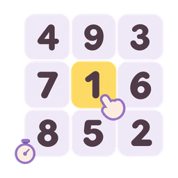
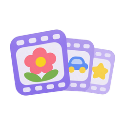

  

<h1 align="center">BrainLite: Focus Training</h1>

用一局小游戏，练习专注、记忆和有条理地思考。

<a href="#认识-brainlite">认识 BrainLite</a> · <a href="#联系我们">技术支持</a> · <a href="#english">English</a>

## 认识 BrainLite

BrainLite 是 MomentIdea 开发的 iPhone 训练应用，收录了涉及注意力、记忆、反应和规划的小游戏。每局结束后可以查看结果，也能在训练记录里回看。想养成固定的练习习惯，可以在「我的 → 训练设置」里设置提醒。

### 游戏一览

<table>
  <tr>
    <td align="center"> <strong>舒尔特方格</strong></td>
    <td align="center"> <strong>光点序列</strong></td>
    <td align="center"> <strong>左倾右倒</strong></td>
  </tr>
  <tr>
    <td align="center"> <strong>记忆倒带</strong></td>
    <td align="center"> <strong>鸳鸯配对</strong></td>
    <td align="center"> <strong>不要上当！</strong></td>
  </tr>
</table>

## 联系我们

- **发邮件** · [momentidea.support@gmail.com](mailto:momentidea.support@gmail.com?subject=%5BBrainLite%5D%20%E5%BA%94%E7%94%A8%E5%8F%8D%E9%A6%88)。遇到登录、训练记录、会员或其他使用问题，都可以写信。无法登录 App 时也可以用这个邮箱。
- **在 App 内反馈** · 登录 BrainLite 后，打开「我的 → 帮助与反馈」，选择问题类型，填写说明并提交。

## 邮件怎么写

这个邮箱由 MomentIdea 工作室共用。请以 **`[BrainLite]`** 开头，再写一句具体的问题，例如 `[BrainLite] 换手机后找不到训练记录`。

正文写清楚你想做什么、点了哪里、实际发生了什么。如果方便，请附上 App 版本、iPhone 型号、iOS 版本和截图。App 版本可在「我的」页面底部查看。功能建议可以直接写你希望增加或改进什么。请勿发送密码、验证码或银行卡信息。

---

## English

**BrainLite: Focus Training** is an iPhone app with short games for attention, memory, reaction, and planning. Games include **Number Hunt**, **Light Sequence**, **Color Sort**, **Memory Rewind**, **Perfect Pairs**, and **Don’t Fall for It!**. View your results after each round and revisit them in your practice history.

- **Email** · [momentidea.support@gmail.com](mailto:momentidea.support@gmail.com?subject=%5BBrainLite%5D%20App%20feedback). For help with sign-in, practice history, membership, or other issues, email us even if you can't sign in.
- **In-app feedback** · After signing in, open **Me › Help & Feedback**, select a topic, and submit your message.

This inbox is shared across MomentIdea apps. Start your subject with **`[BrainLite]`** and add a short description, such as `[BrainLite] Practice history missing after switching phones`.

Tell us what you were trying to do, the steps you took, and what happened. If available, include your app version, iPhone model, iOS version, and a screenshot. The app version is under **Me › About BrainLite**. For a feature request, tell us what you'd like to do in the app. Please leave out passwords, verification codes, and payment card details.
